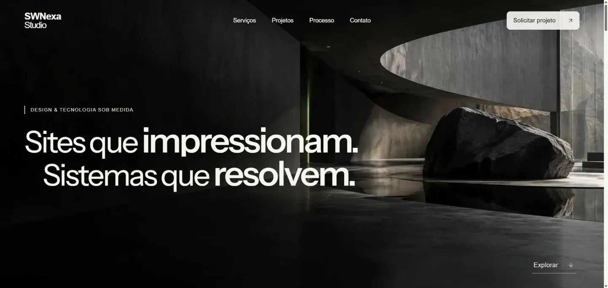

# SWNexa Studio

Iniciativa independente de desenvolvimento de sites, sistemas e experiências digitais, conduzida paralelamente à minha trajetória profissional em tecnologia.

Este repositório apresenta o site institucional da SWNexa Studio e quatro experiências autorais. O projeto aplica conhecimentos de frontend, arquitetura de componentes, responsividade, acessibilidade e integração de serviços, complementando minha experiência como desenvolvedor.

**[Visitar o site oficial](https://studio.swnexa.com/)**



## Objetivo e tecnologias

Apresentar serviços de desenvolvimento digital a potenciais clientes e explorar diferentes linguagens de interface.

Next.js App Router, React, TypeScript, Tailwind CSS 4, CSS Modules, Framer Motion, Lucide e Resend. WhatsApp oferece uma alternativa direta de contato. Não há banco de dados ou autenticação.

## Experiências conceituais

| Experiência                                           | Proposta                                                                    |
| ----------------------------------------------------- | --------------------------------------------------------------------------- |
| [Atelier](https://studio.swnexa.com/projetos/atelier) | Editorial de arquitetura e direção de arte.                                 |
| [Amora](https://studio.swnexa.com/projetos/amora)     | Gastronomia e hospitalidade, com ilustrações e composição interativa.       |
| [Orbit](https://studio.swnexa.com/projetos/orbit)     | Interface de tecnologia e produto, com indicadores e simulação local.       |
| [Volt](https://studio.swnexa.com/projetos/volt)       | Música, cultura e entretenimento, com programação e acessos demonstrativos. |

São experiências autorais, **não projetos entregues a clientes reais**. Marcas, indicadores, reservas, artistas e ingressos são fictícios; as interações não realizam reservas, contratações ou pagamentos.

## Arquitetura e frontend

- src/app: páginas, API de contato e metadados nativos do Next.js.
- src/components: layout, seções, elementos de interface e componentes específicos de cada conceito.
- src/data: conteúdo e dados demonstrativos tipados.
- src/lib/contact.ts: contrato e validação compartilhada do contato.
- src/styles e CSS Modules: identidade global, estilos locais e responsividade.
- tests: testes de contato e integridade da navegação pública.

As páginas combinam componentes de servidor com componentes de cliente nos pontos de interação. Imagens usam recursos do Next.js e as fontes são servidas pelo projeto via next/font. Animações respeitam movimento reduzido; controles incluem identificação de campos, feedback acessível e navegação por teclado.

## Contato comercial

O formulário envia JSON para POST /api/contact. A API valida os campos, limita o corpo e envia texto simples pelo Resend, com o e-mail do visitante em Reply-To. A interface informa carregamento, sucesso e erro, preserva dados em falhas e bloqueia cliques simultâneos. A idempotência mantém tentativas repetidas do mesmo envio consistentes.

Um honeypot complementa essas verificações; não é proteção completa contra spam nem limitação de frequência. Proteções adicionais da hospedagem podem ser avaliadas separadamente, sem serviços novos neste projeto.

## Testes e qualidade

Node.js 24 e npm:

```sh
npm ci
npm run lint
npm run typecheck
npm test
npm run build
```

O GitHub Actions executa essas verificações em PRs para master e pushes na master e em branches portfolio/**. Os testes usam o runner nativo do Node.js e Resend simulado, sem credenciais reais ou e-mails enviados. Cobrem validação, tamanho, origem, idempotência, honeypot, erros do fornecedor e integridade das experiências públicas. Não substituem um teste autorizado de entrega real.

## Execução local

```sh
git clone https://github.com/guilhermehgl/swnexa-studio.git
cd swnexa-studio
npm ci
npm run dev
```

Abra http://localhost:3000. Copie .env.example para .env.local se precisar configurar o contato, preservando arquivos existentes. Para servir o build: npm run build e npm start.

## Publicação e configuração

A Vercel publica a master em [studio.swnexa.com](https://studio.swnexa.com/). Branches podem gerar previews automáticos; o CI verifica qualidade, sem executar deploy manual. Canonicals, sitemap, robots e imagem de compartilhamento usam recursos nativos do Next.js.

| Variável                    | Finalidade                                      |
| --------------------------- | ----------------------------------------------- |
| RESEND_API_KEY              | Chave privada, somente no servidor.             |
| CONTACT_TO_EMAIL            | Destinatário comercial.                         |
| CONTACT_FROM_EMAIL          | Remetente de domínio verificado no Resend.      |
| NEXT_PUBLIC_WHATSAPP_NUMBER | Número público com país e DDD, somente dígitos. |

Não versione segredos ou .env.local. Sem as três variáveis privadas, a API retorna indisponibilidade e não simula sucesso. O WhatsApp é incorporado no build. A entrega de e-mail depende da configuração do Resend e deve ser testada somente com autorização.

## Autor

[Guilherme Henrique Guimarães Lima](https://github.com/guilhermehgl)
